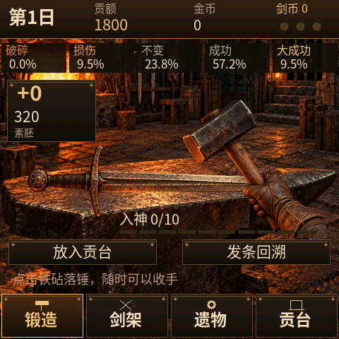
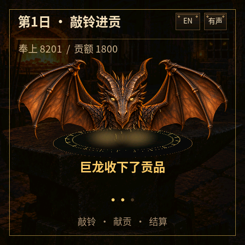

# Bailian Forge · 百炼

在掌心铁匠铺里，将一块刀胚锻成名剑。每次落锤都可能强化、损伤或碎刀；
决定何时收手、搭配哪些遗物，在不断上涨的贡额中挑战 21 日契约。

- 480×480 触摸界面，固定第一人称铁匠铺，支持中英文切换。
- 10 个剑系与 50 种剑体形态，强化阶段改变刀刃、护手与纹饰。
- 94 件经典遗物、7 种商人道具，以及通关后的延长契约。
- 连贯加热、快速落锤、入神爆发与进贡仪式，支持音效、震动及静音设置。
- 主机预览与设备共用 C 规则及渲染器，设备自动保存游戏进度。

剑体动画、英文界面及进贡巨龙图片来自原生测试场景。支持顶部 EN / ZH 和暂停菜单即时切换语言，适用于
ESP-Mosaico / ESP32-S31。玩法受 ForgeTax 启发，规则独立实现，图像通过
ImageGen 生成，音效由程序合成。

[源码与运行说明](https://github.com/Horion0415/Bailian-Forge)
· [素材与规则来源](https://github.com/Horion0415/Bailian-Forge/blob/main/projects/bailian/ASSETS.md)

版本 0.3.2 重绘进贡巨龙的鳞甲、弯角与翼膜，新增呼吸、收贡点头及震怒反应；包含发条回溯修复与中英文切换。

0.3.2 已在 ESP-Mosaico 上通过应用更新、固件校验、启动和存档恢复检查，静音设置可正常保留。
平台下载后的首次安装仍待验证；此前 Vibe Mode 0.1.4 的一次完整更新在传输中重启，原因尚未确认。
